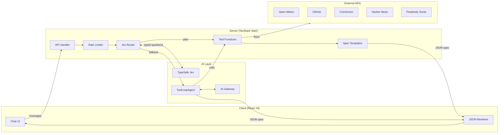

# [Kite](https://kite.netlify.app)

Kite is an AI-powered data exploration assistant that helps you discover and visualize information about any topic. Ask questions about weather, crypto prices, GitHub repositories, or news, and Kite fetches real-time data and builds interactive dashboards.

## Architecture



- **Client**: React 19 UI with streaming chat. Renders responses as JSON-defined UI components.
- **Server**: A TanStack Start API route (`/api/generate`) handles rate limiting, then tries the Jev router before handing off to the LLM agent.
- **Jev router** (`src/lib/router`): One [TypeSafe](https://typesafe.ai) Jev request answers which data sources the user wants and which arguments they mean. Code fetches the data and builds the dashboard from fixed templates, with no LLM involved.
- **Agent** (`src/lib/agent.ts`): A ToolLoopAgent behind the AI Gateway. It handles everything the router doesn't cover, calls tools, and writes the JSON UI spec itself.
- **Tools** (`src/lib/tools`): Server-side functions that fetch real data. The router and the agent share them.

## How It Works

1. **You send a message** asking about any topic (weather, crypto, GitHub, etc.).
2. **The Jev router reads it first** (only when `TYPESAFE_API_KEY` is set). It asks yes/no and multiple-choice questions about the message and about candidate cities, coins, repos and counts that code pulls out of the text.
3. **When the answers are clear**, the router fetches the data and returns a templated dashboard straight away.
4. **Otherwise the request falls back to the LLM agent.** This covers other topics, explanations, quizzes, 3D scenes, answers that fall between the 0.3 and 0.7 thresholds, and any TypeSafe error. The agent calls tools and streams a summary plus a JSON UI spec.
5. **The UI renderer** turns the spec into interactive React components with `@json-render/react`.

### Router layout

| File            | Purpose                                                         |
| --------------- | --------------------------------------------------------------- |
| `questions.ts`  | All question wording and the yes/no thresholds (0.7 / 0.3)      |
| `candidates.ts` | Code-extracted cities, repos, coins and counts                  |
| `request.ts`    | Builds the TypeSafe request from the message and chat history   |
| `decide.ts`     | Truth table that turns answers into a plan or a fallback        |
| `templates.ts`  | Deterministic specs per tool, with single and comparison views  |
| `index.ts`      | Runs the request, fetches data, and assembles the spec and text |

## Tech Stack

- **Framework**: TanStack Start on Vite (file-based routing, server routes)
- **UI**: React 19 (with React Compiler) + shadcn/ui + TailwindCSS 4
- **AI**: AI SDK `ToolLoopAgent` + `@ai-sdk/gateway` (default model `anthropic/claude-haiku-4.5`)
- **Routing model**: `@typesafe-ai/sdk` (Jev)
- **Rendering**: [json-render](https://json-render.dev/)
- **Charts**: Recharts + React Three Fiber (3D)
- **Rate limiting**: `@upstash/ratelimit` + `@upstash/redis`
- **Logging**: evlog
- **Tooling**: Biome, Vitest
- **Deployment**: Netlify

## Available Tools

| Tool                    | Data source                   | Jev router |
| ----------------------- | ----------------------------- | ---------- |
| `getWeather`            | Open-Meteo                    | Yes        |
| `getGitHubRepo`         | GitHub API                    | Yes        |
| `getGitHubPullRequests` | GitHub API                    | Yes        |
| `getCryptoPrice`        | CoinGecko                     | Yes        |
| `getCryptoPriceHistory` | CoinGecko                     | Yes        |
| `getHackerNewsTop`      | Hacker News API               | Yes        |
| `webSearch`             | Perplexity Sonar (AI Gateway) | Agent only |

## Component Library

The agent can generate these components through JSON specs:

- **Layout**: Stack, Grid, Card, Tabs, TabContent, Accordion, Separator
- **Content**: Heading, Text, Badge, Callout, Alert, Link, Timeline, Progress, Skeleton
- **Data**: Metric, Table, BarChart, LineChart, PieChart
- **Input**: Button, RadioGroup, SelectInput, TextInput
- **3D**: Scene3D, Group3D, Box, Sphere, Cylinder, Cone, Torus, Plane, Ring, AmbientLight, PointLight, DirectionalLight, Stars, Label3D

Components support data binding with the `{ "$state": "/path" }` syntax. Fetched data goes into state, and components bind to it.

## Environment Variables

Copy `.env.example` to `.env`.

| Variable                                      | Required | Purpose                                                   |
| --------------------------------------------- | -------- | --------------------------------------------------------- |
| `AI_GATEWAY_API_KEY`                          | Yes      | Vercel AI Gateway key for the agent and web search        |
| `AI_GATEWAY_MODEL`                            | No       | Overrides the agent model                                 |
| `TYPESAFE_API_KEY`                            | No       | Turns on the Jev router; without it every request uses the agent |
| `KV_REST_API_URL`, `KV_REST_API_TOKEN`        | No       | Upstash Redis for rate limiting; without them limits are off |
| `RATE_LIMIT_PER_MINUTE`, `RATE_LIMIT_PER_DAY` | No       | Per-IP limits (defaults 10 and 100)                       |

## Development

```bash
bun dev          # Start dev server on port 3000
bun run build    # Production build
bun run test     # Run tests (Vitest)
bun run lint     # Biome lint
bun run format   # Biome format
bun run check    # Biome lint + format check
```
